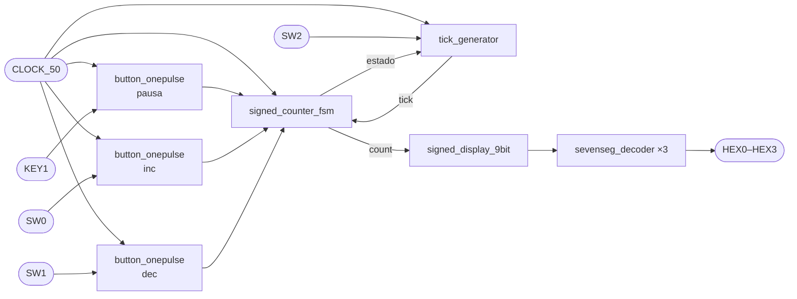

<div align="center">

# Contador con signo de 9 bits — DE10-Lite

**Práctica 3 · Sistemas Embebidos**


</div>

---

## Descripción

Contador ascendente/descendente de **9 bits con signo** (rango −256 a 255) implementado en Verilog para la FPGA Intel MAX 10 de la tarjeta **DE10-Lite**. El valor se muestra en decimal en cuatro displays de siete segmentos, con el signo negativo en `HEX3`.

### Características

- Conteo ascendente y descendente
- Pausa y reinicio
- Dos intervalos de actualización: **1 s** y **100 ms**
- Antirrebote de 10 ms en todas las entradas
- LEDs que indican el estado actual de la máquina de estados

---

## Controles

| Entrada | Función |
|:---:|---|
| `KEY0` | Reinicio (activo en bajo) |
| `KEY1` | Pausa |
| `SW0` | Contar hacia arriba |
| `SW1` | Contar hacia abajo |
| `SW2` | Velocidad (0 = 1 s, 1 = 100 ms) |

| Salida | Significado |
|:---:|---|
| `HEX2`–`HEX0` | Centenas, decenas y unidades |
| `HEX3` | Signo `-` cuando el número es negativo |
| `LEDR0` / `LEDR1` / `LEDR2` | Estado: PAUSA / ARRIBA / ABAJO |
| `LEDR3` | Velocidad seleccionada (`SW2`) |
| `LEDR9` | Sistema activo (fuera de reinicio) |

---

## Arquitectura



| Módulo | Descripción |
|---|---|
| `top.v` | Módulo principal: conecta todo a los pines de la tarjeta |
| `button_onepulse.v` | Sincronizador + antirrebote de 10 ms; genera un pulso por pulsación |
| `tick_generator.v` | Divisor de reloj: un tick cada 1 s o cada 100 ms |
| `signed_counter_fsm.v` | Máquina de estados (PAUSA / ARRIBA / ABAJO) y contador |
| `signed_display_9bit.v` | Convierte el valor con signo a centenas, decenas y unidades |
| `sevenseg_decoder.v` | Decodificador BCD → 7 segmentos (activo en bajo) |
| `TB_counter_9bit_top.v` | Testbench |

### Diagrama RTL


---

## Simulación

El testbench verifica el reinicio, el conteo ascendente, la pausa, el conteo descendente pasando por cero hacia negativos y el cambio a la velocidad rápida.


---

## Cómo usarlo

1. Clona el repositorio:
   ```bash
   git clone https://github.com/JosManuel180843/Practica_3_Sistemas_Embebidos.git
   ```
2. Abre `practica3.qpf` en **Quartus Prime 21.1 Lite**.
3. Compila con **Processing → Start Compilation**.
4. Programa la DE10-Lite desde **Tools → Programmer** con el archivo `output_files/practica3.sof`.

---

## Autores
Jose Manuel Daniel Morales
Anellise Herrera
Abril Morales

- **Sebastian Torres**
- **José Manuel** — [@JosManuel180843](https://github.com/JosManuel180843)
